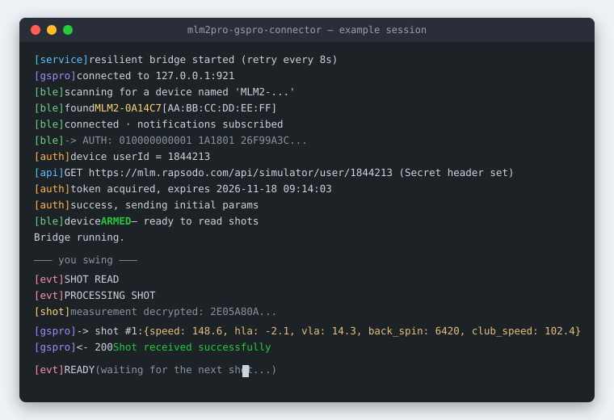
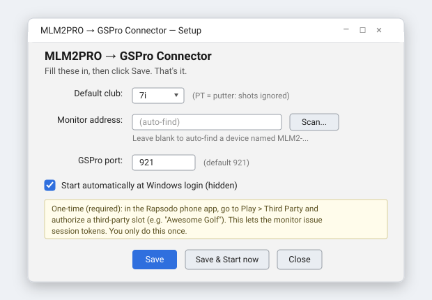

# MLM2PRO → GSPro Connector

Connect a **Rapsodo MLM2PRO** launch monitor directly to your PC over Bluetooth
LE and feed shots straight into **GSPro** via its OpenConnect API — **with the
Rapsodo phone app out of the loop while you play.**

It runs as a lightweight background service: it waits for GSPro, finds your
monitor, fetches a fresh session token automatically each time, arms the device,
and forwards every shot to GSPro. It auto-reconnects if the monitor sleeps, and
if Rapsodo's daily authorization lapses it pops a clear alert telling you exactly
what to tap.

> **Interoperability tool for people who own the hardware and the software.**
> Not affiliated with, endorsed by, or supported by Rapsodo or GSPro. See
> [CREDITS.md](CREDITS.md) for trademarks and attribution.

<p align="center">
  
</p>

---

## ⚠️ What it does and doesn't do (read this first)

Rapsodo requires that third-party access be **re-authorized in their phone app
every 24 hours**. This is enforced on your Rapsodo account / the device itself,
*upstream* of the Bluetooth link — so **no connector can remove it**, including
this one, the projects it's based on, and even the official TruGolf/E6 and
Awesome Golf integrations. ([Awesome Golf docs][ag], [TruGolf E6 docs][e6].)

| What you were hoping for | Reality |
|---|---|
| No Rapsodo phone app running *during play* | ✅ Yes |
| Session token fetched automatically every launch (no login screen) | ✅ Yes |
| Headless auto-start, direct BLE → GSPro, auto-reconnect | ✅ Yes |
| **Never open the Rapsodo app again** | ❌ **No — Rapsodo forces a re-auth every 24h** |

So in practice: **tap authorize once at the start of your day** and you're set
until the 24-hour window expires. If it lapses mid-session (e.g. the monitor was
used another way in between), this tool detects it and shows you the fix instead
of failing silently.

[ag]: https://insights.awesome-golf.com/docs/reference/apps/with-rapsodo-mlm2pro
[e6]: https://trugolf.zohodesk.com/portal/en/kb/articles/connecting-the-rapsodo-mlm2pro-device-to-e6-connect

## Features

- **Direct BLE → GSPro** — talks to the MLM2PRO over Bluetooth, decodes shots,
  sends them to GSPro OpenConnect (`127.0.0.1:921`).
- **Automatic token fetch** — grabs the session token the same way the official
  app does, on every run, so there's no login screen in your way. (This is *not*
  the 24h re-auth above — see that section.)
- **Expiry alerts, not silent failure** — when Rapsodo's authorization lapses,
  a Windows alert tells you exactly what to tap to fix it.
- **Resilient service mode** — one persistent GSPro connection, auto-reconnect to
  the monitor, quiet rotating log. Designed to run hidden at logon and just work.
- **One-file executable** — build a single `.exe`; end users don't need Python.
- **Windows auto-start** — per-user, no admin required.

## Requirements

- Windows 10/11 with Bluetooth.
- A Rapsodo MLM2PRO.
- GSPro with the OpenConnect API enabled.
- A Rapsodo **third-party** subscription (this is what makes the 24h authorization
  available at all).

## The daily step (required by Rapsodo)

Once per 24 hours, in the **Rapsodo phone app** with the monitor connected:

> `Play → 3rd Party Apps → GSPro → Authenticate Now`

Then close the app. That authorization stays valid for 24 hours. The connector
handles everything else — it needs no phone app while you actually play, and it
fetches the per-session token for you automatically. You cannot skip the 24h tap;
it's a Rapsodo policy, not a limitation of this tool.

## Quick start (one-click setup)

1. Pair the MLM2PRO in Windows Bluetooth settings (pick the `MLM2-<serial>` entry).
2. Double-click **`Configure.bat`**. A small window opens — pick your club, optionally
   **Scan** for your monitor, and click **Save & Start now**. You can also tick
   "Start automatically at Windows login".
3. Start GSPro and open its OpenConnect API. Done.

<p align="center">
  
</p>

The setup window writes a `config.json` next to the program; the connector reads it
on every launch, so you never touch the command line. Re-run `Configure.bat` any time
to change your club or device.

## Demo

A real swing → GSPro recording needs actual hardware, so it isn't checked in here.
To capture your own for this README: start GSPro + the connector, run a free
recorder ([ScreenToGif](https://www.screentogif.com/)) over the connector window
and the GSPro shot readout, hit one ball, and save as `docs/demo.gif`. Then add:

```markdown
<p align="center"></p>
```

## Install & run (manual)

### Option A — one-file executable (easiest)

1. Download `mlm2pro-gspro-connector.exe` from the
   [Releases](https://github.com/adamkoehler1990/mlm2pro-gspro-connector/releases)
   page (or build it: `powershell -ExecutionPolicy Bypass -File scripts\build_exe.ps1`).
2. Pair the MLM2PRO in Windows Bluetooth settings (pick the `MLM2-<serial>` entry).
3. Start GSPro and open its OpenConnect API.
4. Run it:

```bash
mlm2pro-gspro-connector.exe --service --club 7i
```

### Option B — from source

```bash
pip install -r requirements.txt
python mlm2pro_bridge.py --service --club 7i
```

(Requires Python 3.10+.)

### Options

```bash
--service                 resilient background mode (recommended)
--address AA:BB:...       connect to a specific monitor, skip the scan
--club 7i                 set the reported club (PT = putter, shots ignored)
--gspro-port 921          GSPro OpenConnect port
--log PATH                log file location (service mode)
--retry 8                 seconds between reconnect attempts
```

### config.json

Instead of flags you can drop a `config.json` next to the program (this is what
`Configure.bat` writes). See [`config.example.json`](config.example.json):

```json
{
  "club": "7i",
  "address": null,
  "gspro_host": "127.0.0.1",
  "gspro_port": 921,
  "retry": 8
}
```

Command-line flags override `config.json` when both are present.

## Run automatically at Windows logon (hidden)

```bash
powershell -ExecutionPolicy Bypass -File scripts\install_autostart.ps1
```

Drops a hidden-launch shortcut in your per-user **Startup folder** (no admin). It
prefers the built `.exe` if present, otherwise uses Python. Edit `$Club` in the
script to change your default club. Remove with `scripts\uninstall_autostart.ps1`.

**Check it's alive:** open `mlm2pro_bridge.log`.

## How it works

1. Connects to the MLM2PRO over BLE.
2. Runs the auth handshake → the device returns a user id.
3. Fetches a session token from Rapsodo's web API for that id.
4. Writes the encrypted initial parameters (incl. the token) and arms the device.
5. Decodes each shot (AES-256-CBC) and sends it to GSPro OpenConnect.

## Troubleshooting

- **A "re-authorize needed" alert popped up / the monitor stays red and won't
  connect** — Rapsodo's 24-hour authorization has expired. Open the Rapsodo app →
  `Play → 3rd Party Apps → GSPro → Authenticate Now`, close it, and the connector
  reconnects on its own. This is expected roughly once a day.
- **GSPro shows "not ready" but the connector is running** — GSPro's indicator
  typically clears when it receives the first real shot. If the log shows
  `202 GSPro ready`, the pipeline is connected; just hit a ball.
- **Connector connects but no ball flies / no response on 921** — GSPro Connect is
  single-connection and doesn't clean up old sockets. Quit and relaunch GSPro to
  clear port 921, then start the connector **once** and leave it running. Don't
  run two clients against 921 at the same time.
- **Shot misreads** — 20 zero bytes from the device = a misread; it's ignored.

## Contributing

Issues and PRs welcome. Because this builds on GPL-3.0 upstream work, the project
is GPL-3.0; contributions are accepted under the same license.

## License

**GPL-3.0** — see [LICENSE](LICENSE). Portions derived from
[springbok/MLM2PRO-GSPro-Connector](https://github.com/springbok/MLM2PRO-GSPro-Connector)
(GPL-3.0) and [Duwaynef/MLM2PRO-BT-APP](https://github.com/Duwaynef/MLM2PRO-BT-APP)
(MIT). Full attribution in [CREDITS.md](CREDITS.md).
